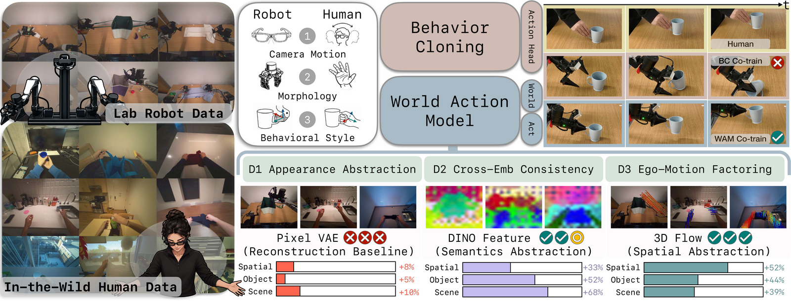

# EgoWAM: World Action Models Beyond Pixels with In-the-Wild Egocentric Human Data

**[Baoyu Li](https://boey-li.github.io)\*, [Xinchen Yin](https://xinchenyin.github.io/)\*, [Mengying Lin](https://cassie-lim.github.io/), [Yixin Zhang](https://www.linkedin.com/in/yixin-zhang-b94069408/), [Danfei Xu](https://faculty.cc.gatech.edu/~danfei/)**

Georgia Institute of Technology &nbsp;•&nbsp; CoRL 2026

[Project Page](https://gatech-rl2.github.io/egowam.github.io) &nbsp;|&nbsp; [arXiv](https://arxiv.org/abs/2607.08436) &nbsp;|&nbsp; [Data](https://partners.mecka.ai/egoverse?task=EgoWAM_fold_clothes#explorer) &nbsp;|&nbsp; [Checkpoints](https://huggingface.co/boeyyyy/EgoWAM-checkpoints)



## 💗 Citation

```bibtex
@article{li2026egowam,
  title   = {EgoWAM: World Action Models Beyond Pixels with In-the-Wild Egocentric Human Data},
  author  = {Li, Baoyu and Yin, Xinchen and Lin, Mengying and Zhang, Yixin and Xu, Danfei},
  journal = {arXiv preprint arXiv:2607.08436},
  year    = {2026}
}
```

## 📋 Table of Contents

- [🛠️ Installation](docs/install.md)
- [🖥️ Data](docs/data.md)
- [🧠 Training](docs/training.md)
- [🤖 Simulation (RoboTwin)](docs/robotwin.md)
- [🦾 Real-Robot Deployment](docs/hardware.md)
- [❓ Troubleshooting](docs/troubleshooting.md)

## 📁 Code Structure

```
EgoWAM/
├── egowam/
│   ├── trainHydra.py            # training entrypoint (Hydra + Lightning)
│   ├── algo/                    # HPT world-action model
│   ├── models/                  # stems, trunk, flow-matching action head, WM heads
│   ├── rldb/                    # zarr data layer, embodiment keymaps + transforms
│   ├── hydra_configs/           # model / data / trainer / launcher configs
│   ├── pl_utils/                # Lightning module + datamodule wrappers
│   ├── robot/                   # real-robot stack (ARX5 + Aria + RealSense)
│   ├── resources/               # robot kinematics model (model_x5.xml)
│   ├── compat.py                # alias for pre-rename checkpoints
│   └── scripts/
│       ├── data_download/       # S3 / SQL episode sync
│       ├── eva_process/         # robot demos  -> zarr
│       ├── aria_process/        # human video  -> zarr
│       ├── 3dflow_process/      # Track4World 3D-flow targets
│       ├── rae_process/         # RAE stage-1 decoder training
│       ├── robotwin_process/    # simulation bridge, deploy + eval
│       └── evaluation/          # checkpoint validation
├── external/                    # vendored: RoboTwin, RAE, Track4World, cosmos-policy
├── sbatch/                      # cluster launchers (6 training + robotwin)
├── docs/                        # documentation
├── assets/                      # teaser + figures
└── pyproject.toml
```

## 🔑 Method Variants

All variants share the trunk and the flow-matching action head, and differ only in the world target.

| Paper name | World target | Robot-only config | Co-train config | Launcher |
|---|---|---|---|---|
| **BC** | none (action only) | `model/hpt_bc_eva` | `model/hpt_bc_cotrain` | `hpt_eva.sh`, `hpt_cotrain.sh` |
| **Pixel** | Wan VAE latent of the future frame | `model/hpt_wm_eva` | `model/hpt_wm_cotrain` | `hpt_wm_vae.sh` |
| **Pixel-PT** | same target, head pretrained on Wan2.1 video | `model/hpt_wm_eva_pixelpt` | `model/hpt_wm_cotrain_pixelpt` | `hpt_wm_pixelpt.sh` |
| **DINO** | DINOv2 patch features, RAE wide-DDT head | `model/hpt_wm_eva_rae` | `model/hpt_wm_cotrain_rae` | `hpt_wm_rae.sh` |
| **3D Flow** | camera-stabilized dense 3D motion field | `model/hpt_wm_eva_3dflow` | `model/hpt_wm_cotrain_3dflow` | `hpt_wm_3dflow.sh` |

## ⚡ Quickstart

```bash
git clone https://github.com/GaTech-RL2/EgoWAM.git && cd EgoWAM
uv venv emimic --python 3.11 && source emimic/bin/activate
uv pip install -r requirements.txt
uv pip install -e .

export EGOWAM_DATA_ROOT=/path/to/zarr_datasets

# BC co-training on a 1% slice -- fastest check, no third-party assets at all
python egowam/trainHydra.py --config-name=train_zarr.yaml \
  data=debug model=hpt_bc_cotrain trainer=debug \
  name=debug description=smoke

# DINO co-training on a 1% slice -- ~10 min, needs the stage-1 decoder (docs/install.md)
python egowam/trainHydra.py --config-name=train_zarr_wm.yaml \
  data=debug_wm model=hpt_wm_cotrain_rae trainer=debug \
  model.robomimic_model.wm_prediction_mode=joint \
  model.robomimic_model.training_stage=3 \
  'model.robomimic_model.auxiliary_ac_keys.eva_bimanual=[future_image_latent]' \
  'model.robomimic_model.auxiliary_ac_keys.aria_bimanual=[future_image_latent]' \
  model.robomimic_model.auxiliary_loss_weights.future_ee_pose=0.0 \
  model.robomimic_model.auxiliary_loss_weights.future_flow=0.0 \
  name=debug description=smoke

# 3D-flow co-training on a 1% slice -- needs no gated assets
# First run also computes point-flow statistics (~40 min, cached afterwards); see docs/troubleshooting.md
python egowam/trainHydra.py --config-name=train_zarr_wm.yaml \
  data=debug_wm3dflow model=hpt_wm_cotrain_3dflow flow3d=point3d trainer=debug \
  name=debug description=smoke
```

Episodes are synced on demand into `EGOWAM_DATA_ROOT` the first time a config referencing them is
trained — configure credentials once first, per [docs/data.md](docs/data.md#access-and-download).

Full setup in [docs/install.md](docs/install.md); every variant and regime in
[docs/training.md](docs/training.md).

> **On the full splits, expect a slow start.** The smoke run above finishes in minutes, but
> normalization statistics are computed over the whole dataset before epoch 0 and are I/O-bound —
> tens of minutes on the flagship splits. No epoch logged for the first hour is normal, not a hang.

## 🙏 Acknowledgements

This repository is built on [EgoVerse](https://github.com/GaTech-RL2/EgoVerse), an ecosystem for
egocentric human data processing and BC algorithm training.
