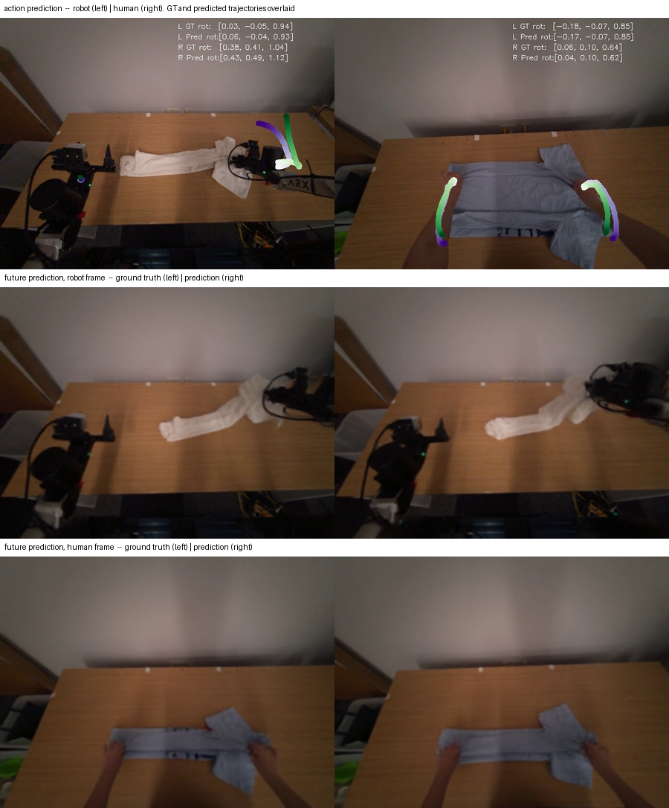

# 🧠 Training

- [Variants and launchers](#variants-and-launchers)
- [Single GPU](#single-gpu)
- [SLURM](#slurm)
- [Vision encoder (stem)](#vision-encoder-stem)
- [RAE stage 1 (optional)](#rae-stage-1-optional)
- [Evaluating a checkpoint](#evaluating-a-checkpoint)
- [What training produces](#what-training-produces)
- [Validation metrics](#validation-metrics)
- [Configuration reference](#configuration-reference)

## Variants and launchers

Every variant shares the trunk and the flow-matching action head and differs only in the world
prediction target. On SLURM, one launcher per method covers every task and regime:

```bash
sbatch sbatch/hpt_eva.sh       <task>            # BC, robot only
sbatch sbatch/hpt_cotrain.sh   <task> [regime]   # BC + human
sbatch sbatch/hpt_wm_vae.sh    <task> [regime]   # Pixel
sbatch sbatch/hpt_wm_rae.sh    <task> [regime]   # DINO
sbatch sbatch/hpt_wm_3dflow.sh <task> [regime]   # 3D Flow

sbatch sbatch/hpt_wm_rae_dinov2.sh <task> [regime]  # DINO, with a DINOv2 stem instead of ResNet-18
```

- `task` — `cup_saucer`, `fold_clothes`, `bag_grocery`
- `regime` — `eva` (robot only), `indomain` (1:1 human), `everseA` (~10:1 EgoVerse split, default)

The world-model launchers derive the robot-only or co-train model config from `regime`, so the
model and data configs can never disagree. Any further arguments pass through to Hydra verbatim:

```bash
sbatch sbatch/hpt_wm_3dflow.sh cup_saucer everseA trainer.max_epochs=2000
```

Which variant needs which third-party asset is in
[install.md](install.md#gated-and-third-party-assets). BC and 3D-flow need none.

## Single GPU

```bash
# BC co-training
python egowam/trainHydra.py --config-name=train_zarr.yaml \
  data=cup_saucer/everseA model=hpt_bc_cotrain \
  name=cup_saucer description=bc_flagship

# Pixel co-training
python egowam/trainHydra.py --config-name=train_zarr_wm.yaml \
  data=cup_saucer/everseA_wm model=hpt_wm_cotrain \
  name=cup_saucer description=pixel_flagship

# DINO (RAE) co-training
# The model config declares future_ee_pose and future_flow alongside future_image_latent, but the
# `_wm` data split publishes only the latent -- so the auxiliary keys must be narrowed, exactly as
# sbatch/hpt_wm_rae.sh does. Without these two overrides the run dies with
# `KeyError: Missing key eva_bimanual_future_ee_pose`.
python egowam/trainHydra.py --config-name=train_zarr_wm.yaml \
  data=cup_saucer/everseA_wm model=hpt_wm_cotrain_rae \
  model.robomimic_model.wm_prediction_mode=joint \
  model.robomimic_model.training_stage=3 \
  'model.robomimic_model.auxiliary_ac_keys.eva_bimanual=[future_image_latent]' \
  'model.robomimic_model.auxiliary_ac_keys.aria_bimanual=[future_image_latent]' \
  model.robomimic_model.auxiliary_loss_weights.future_ee_pose=0.0 \
  model.robomimic_model.auxiliary_loss_weights.future_flow=0.0 \
  name=cup_saucer description=dino_flagship

# 3D flow co-training
python egowam/trainHydra.py --config-name=train_zarr_wm.yaml \
  data=cup_saucer/everseA_wm3dflow model=hpt_wm_cotrain_3dflow flow3d=point3d \
  name=cup_saucer description=flow_flagship
```

`flow3d=point3d` is required for the 3D-flow variant — it adds the point-flow keys to the data
schematic. Without it the loader never publishes them and the flow head trains on nothing.

> **Expect a slow start.** Normalization statistics are computed over the dataset before epoch 0
> and are I/O-bound — tens of minutes on the flagship splits.

## SLURM

The launchers set sensible defaults and accept overrides through the environment:

| Variable | Purpose |
|---|---|
| `EGOWAM_VENV` | virtualenv to activate (default `$ROOT/emimic`) |
| `EGOWAM_DATA_ROOT` | dataset root |
| `EGOWAM_ROOT` | repo root (defaults to `$SLURM_SUBMIT_DIR`) |
| `TMPDIR_OVERRIDE` | scratch directory — must be node-local, never NFS |

```bash
sbatch --export=ALL,EGOWAM_DATA_ROOT=/data/zarr sbatch/hpt_wm_3dflow.sh cup_saucer everseA
```

Logs land in `sbatch_logs/<job>_<id>.{out,err}`; run directories in
`logs/<name>/<description>_<timestamp>/`.

## Vision encoder (stem)

Every flagship result uses **ResNet-18**, which is what the model configs ship, so training with
it needs no overrides:

```bash
sbatch sbatch/hpt_wm_rae.sh cup_saucer everseA        # ResNet-18, as published
```

A **DINOv2** stem gives much better scene generalization — its pretrained features transfer
across scenes, lighting and backgrounds far more robustly than a ResNet-18 trained from the
demonstration data alone, so it is the better choice when deploying outside the training scenes.
It was explored as an ablation and is not a shipped config.

Switching is not a one-line change: the encoder widens from 256 to 768, so every stem consuming
it has to widen too, and the trunk needs a cross-attention bridge to accept 768-dim context.
`sbatch/hpt_wm_rae_dinov2.sh` applies the whole set, so on SLURM this is all you need:

```bash
sbatch sbatch/hpt_wm_rae_dinov2.sh cup_saucer everseA
```

Interactively, or to apply the same switch to another variant, the overrides are:

```bash
python egowam/trainHydra.py --config-name=train_zarr_wm.yaml \
  data=cup_saucer/everseA_wm model=hpt_wm_cotrain_rae \
  'model.robomimic_model.encoder_specs.front_img_1._target_=egowam.models.hpt_nets.DINOv2Stem' \
  'model.robomimic_model.encoder_specs.front_img_1.output_dim=768' \
  '+model.robomimic_model.encoder_specs.front_img_1.input_size=224' \
  'model.robomimic_model.shared_stem_specs.front_img_1.input_dim=768' \
  'model.robomimic_model.shared_stem_specs.front_img_1.output_dim=768' \
  'model.robomimic_model.shared_stem_specs.front_img_1.widths=[768]' \
  '+model.robomimic_model.shared_stem_specs.front_img_1.specs.cross_attn.crossattn_context_dim=768' \
  name=cup_saucer description=dino_stem
```

The example above covers the front camera only. Wrist cameras need the same treatment — three
encoders (`front_img_1`, `left_wrist_img`, `right_wrist_img`) and three consuming stems (the
shared front stem plus both eva wrist stems); the launcher builds all of them.

## RAE stage 1 (optional)

The DINO variant decodes into RAE latent space, so it needs a stage-1 decoder checkpoint at
`$EGOWAM_RAE_CKPT_ROOT`. Training your own is optional — point the variable at an existing
checkpoint and skip this entirely.

```bash
uv pip install -e '.[rae]'                              # once: pulls torch-fidelity
sbatch egowam/scripts/rae_process/train_stage1.sh [tag]
```

| Variable | Purpose |
|---|---|
| `RAE_STAGE1_DATA` | which stage-1 data config (`data/all_tasks.yaml`, `data/eva_aria_cotrain.yaml`) |
| `EGOWAM_RAE_CKPT_ROOT` | where checkpoints land (default `logs/rae`) |
| `NPROC`, `IMAGE_SIZE`, `PRECISION` | torchrun processes / resolution / dtype |

Checkpoints are written **once per epoch** as `ep-<N>.pt`. On the full three-task mixture an
epoch is ~158k steps, so budget accordingly and expect the first checkpoint only after a full
epoch has completed.

Details, including the two upstream gaps the wrapper closes, are in
`egowam/scripts/rae_process/README.md`.

Published stage-1 weights are on the Hub if you would rather not train one — see
[install.md](install.md#rae-checkpoints--dino-variant).

A trained decoder is only useful if it reconstructs the scene, so it is worth measuring
rather than assuming.

## Evaluating a checkpoint

```bash
python egowam/trainHydra.py --config-name=train_zarr_wm.yaml \
  +validate=true ckpt_path="<run>/checkpoints/epoch_epoch\=1399.ckpt" \
  data=<task>/<data_config>
```

This reconstructs the model from the checkpoint's own `.hydra/config.yaml`, so it works across code
versions. Checkpoints trained before this package was renamed from `egomimic` load transparently
via `egowam/compat.py`.

The `=` in `epoch_epoch=N.ckpt` must be escaped for Hydra, as above.

Our trained checkpoints are on the Hub, so a run in progress can be checked against them rather
than against nothing:

```bash
hf download boeyyyy/EgoWAM-checkpoints \
  policies/fold_clothes_dinov2_c_widetrunk_1799.ckpt --local-dir ./ckpts

python egowam/trainHydra.py --config-name=train_zarr_wm.yaml \
  +validate=true ckpt_path="./ckpts/policies/fold_clothes_dinov2_c_widetrunk_1799.ckpt" \
  data=fold_clothes/everseA_wm
```

## What training produces

Run directories land in `logs/<name>/<description>_<timestamp>/`:

```
checkpoints/epoch_epoch=<N>.ckpt   saved at each validation epoch
videos/epoch_<N>/<EMBODIMENT>/
  action/validation_video_0.mp4    predicted action rollout
  future/validation_video_0.mp4    world-model prediction, ground truth | prediction
.hydra/config.yaml                 the fully resolved config for this run
```

The `future/` videos put ground truth on the left and the model's prediction on the right
(`hpt_wm.py`, `torch.cat([gt_img, pred_img], dim=3)`). The `action/` videos are a single panel
with the ground-truth and predicted end-effector trajectories drawn over the same frame. One
frame from each, for both domains, from a DINO co-train run on fold-clothes in the `indomain`
regime — action prediction on top, then the future prediction for the same robot frame and the
same human frame:



Videos are written only at validation epochs, so with the default
`check_val_every_n_epoch=200` the first ones appear at epoch 199.

## Validation metrics

Each validation epoch logs a full metric dict:

```
[ValMetrics][epoch=599][avg_over_batches] {'Valid/eva_bimanual_actions_cartesian_paired_mse_avg': ...}
```

Metrics are reported per domain — `eva_bimanual` (robot) and `aria_bimanual` (human). The ones
that matter per variant:

| Variant | Action metric | World-model metric |
|---|---|---|
| BC | `actions_cartesian_paired_mse_avg` | — |
| Pixel | `actions_cartesian_paired_mse_avg` | `future_image_latent_pixel_mse_front` |
| DINO | `actions_cartesian_paired_mse_avg` | `future_image_latent_latent_mse_front` |
| 3D Flow | `actions_cartesian_paired_mse_avg` | `future_flow_3d_points_paired_mse_avg` |

**Tolerance.** Run-to-run variation from flow-matching sampling and bf16 reaches ~4e-3 relative,
so a comparison tighter than that is not meaningful. Treat agreement within a few percent as a
match and investigate anything above ~10%.

The full set logged each validation epoch, every one prefixed `Valid/<domain>_`:

**Action head**

| Metric | What it measures |
|---|---|
| `actions_cartesian_paired_mse_avg` | MSE over the whole predicted action chunk |
| `actions_cartesian_final_mse_avg` | MSE at the chunk's final timestep only |
| `actions_cartesian_frechet_gauss_avg` / `_min` / `_max` | Gaussian Fréchet (2-Wasserstein) distance between the predicted and ground-truth time-distributions, per sample |
| `actions_cartesian_reverse_kl_M8` | reverse KL of the predicted action distribution against the target, from M=8 sampled rollouts |

**World-model head** — which ones appear depends on the variant:

| Metric | Variant |
|---|---|
| `future_image_latent_latent_mse_front` | DINO — error in RAE latent space |
| `future_image_latent_pixel_mse_front` / `_avg` | Pixel, DINO — after decoding back to pixels |
| `future_image_latent_pixel_l1_front` / `_avg` | Pixel, DINO |
| `future_flow_3d_points_paired_mse_avg` | 3D Flow |
| `future_flow_3d_points_paired_l1_avg` | 3D Flow |

**Losses**

| Metric | What it is |
|---|---|
| `loss_total` | the optimized objective for that domain |
| `action_head_loss` | flow-matching action loss |
| `aux_head_loss`, `aux/<key>_loss` | world-model head loss, total and per key |
| `shared_loss` | the shared-trunk component |

The `_front` suffix means the front camera specifically; `_avg` averages over the cameras the
variant supplies. `paired` compares prediction to ground truth timestep by timestep.

**Normalization statistics are recomputed every run** and are not cached, which is why startup is
slow. `norm_stat_fraction<1.0` speeds it up but changes the statistics, making it valid only for
same-setting before/after comparisons — never against published numbers.


## Configuration reference

### Entrypoints

| Config | Use |
|---|---|
| `train_zarr.yaml` | BC (action head only) |
| `train_zarr_wm.yaml` | any world-model variant |
| `train_zarr_wm_robotwin.yaml` | RoboTwin simulation |

### Config groups

| Group | Selects |
|---|---|
| `model=` | architecture and world-model head |
| `data=` | `<task>/<regime>` dataset mixture |
| `flow3d=` | `point3d` to publish flow keys, `none` otherwise |
| `trainer=` | `ddp`, `debug` (5 train / 3 val batches, 4 epochs) |

### The data pipeline

A data config composes five pieces per dataset:

```yaml
train_datasets:
  eva_bimanual:
    _target_: egowam.rldb.zarr.zarr_dataset_multi.MultiDataset._from_resolver
    resolver:                     # finds and instantiates episodes
      _target_: egowam.rldb.zarr.zarr_dataset_multi.S3EpisodeResolver
      folder_path: ${paths.data_root}/eva_cup_saucer
      key_map:                    # raw zarr keys -> pre-transform names
        _target_: egowam.rldb.embodiment.eva.Eva.get_keymap
      transform_list:             # frame changes, chunking, concatenation
        _target_: egowam.rldb.embodiment.eva._build_eva_bimanual_transform_list
    filters:                      # applied against the SQL episode table
      task: "EgoWAM_cup_on_saucer"
      scene: "white_wall"
      robot_name: "eva_bimanual"
    mode: total                   # train | valid | percent | total
```

End to end: **filters** → **resolver** finds matching units → units instantiated as zarr datasets →
**MultiDataset** merges them → embodiment **transforms** applied → **DataSchematic** maps
post-transform keys to the batch keys the model expects, carrying shapes and normalization
statistics.

`DataSchematic` computes normalization dynamically at the start of training; `norm_stat_fraction`
(default `1.0`) controls what fraction of the dataset it samples.
